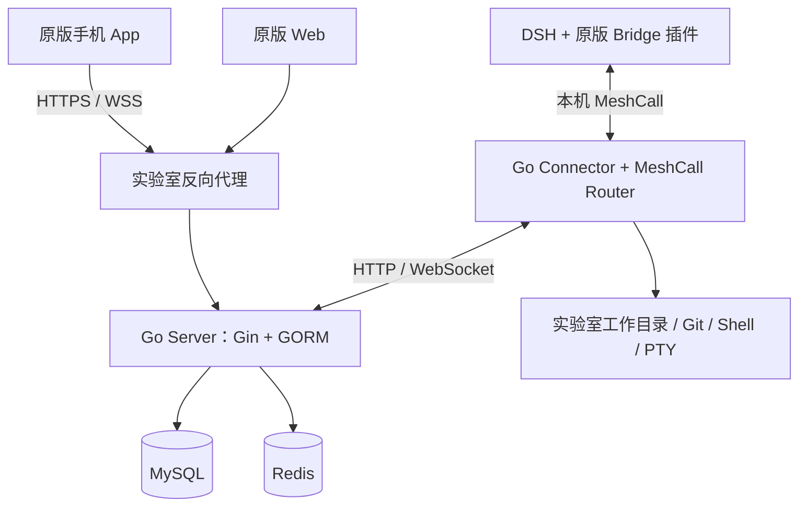

# Agents Anywhere Go 复刻方案与需求清单

版本：规划草案 v1，2026-11-17。

用户已明确：Server 与 Connector 都使用 Go 重写，分阶段完成；Server 使用 Gin＋GORM；复用原版手机端、Web 与 DSH 插件；部署到实验室服务器；提供 Docker 镜像。学习重点是原有后端逻辑、协议兼容、长连接、数据一致性和部署运维。

本文是设计与需求交付，不代表已经实现或验证 Go 版本。各表中的验收标准均为后续开发需要满足的条件。

## 1. 项目目标与范围

项目定位为“Agents Anywhere 的协议兼容 Go 实现”。保留用户现有操作流程：在原版手机 App 中配置实验室服务地址，登录和选择设备，通过原版 DSH 插件查看会话、继续对话、回复输入和审批、操作文件与终端。

交付两个独立程序：

- `aa-server`：替代原项目 `server/`，使用 Go、Gin、GORM、MySQL 和 Redis。
- `aa-connector`：替代原项目 `connector/`，负责本地 Runtime、服务器连接、DSH 桥接、文件、Shell、终端、同步状态和本机控制。使用 Go、MeshCall Go SDK 和原版 MeshCall Router。

Go Connector 的配置、同步检查点和本机运行记录遵循原版文件契约。GORM 主要用于 Server；不要求每个 Connector 连接 MySQL。

复用范围：原版手机 App、Web 界面、DSH 原生 Runtime、DSH 插件业务逻辑、公开契约与 fixtures、MeshCall Router。需要插件自动管理 Go Connector 时，调整插件的启动器与打包层，保持 Bridge 方法和用户交互流程兼容。

完成标准分两层：

1. **DSH 可用版**：原版手机 App → Go Server → Go Connector → 原版 DSH 插件 → DSH 的完整真实链路。
2. **基线全量复刻版**：冻结版本中，目标运行平台适用的 Server API、Connector RPC、Runtime Provider、本机控制和部署行为完成清单核对。DSH 可用版不能直接称为全部 Connector 逻辑已重写。

## 2. 基线与兼容原则

本次源码分析快照为 Agents Anywhere `98dd0e6e5ddc1c5d1b35e1aaea6b5d00bdfd7008`。该快照仅用于确认结构和风险；实际开发先选择一组与用户可下载手机 App 配套的 Server、Connector、DSH 和插件版本。

不能把可下载的旧版手机 App 与持续变化的 main 自动视为兼容组合。若选择 main 作为基线，需要按同一协议版本准备原客户端构建。

兼容性以冻结版本的有效源码、契约、实际网络行为和客户端调用共同确定。名称包含 proposal、target、gap、plan 的文档需要和当前实现核对。

| 兼容面 | 必须保持的内容 |
| --- | --- |
| 手机/Web → Server | `/api/v2` 路径、HTTP 方法、认证、状态码、请求和响应形状、分页、文件流、WebSocket 和恢复事件 |
| Server ↔ Connector | `/connector/auth`、`/connector/ingest`、`/connector/ws`、握手、RPC 信封、通知、错误、超时和实例身份 |
| Connector ↔ DSH 插件 | MeshCall 服务名、方法、metadata、发现文件、鉴权角色、流调用和同步确认 |
| 宿主 → Connector | CLI 参数、环境变量、配置文件、就绪消息、生命周期方法、退出码、本机运行记录 |
| 内容语义 | 稳定 ID、revision、seq、游标、空数组、空对象、null、字段缺省、UTC 时间和错误详情 |

HTTP API v2、平台协议 1.x、Runtime Control 2.x、DSH Bridge 2.x 是不同协议面的版本号，分别记录。

采用独立 API DTO 和数据库模型。禁止直接把 GORM 模型作为客户端 JSON 响应，避免默认字段、软删除、字段命名和零值处理改变原版协议。Go JSON 解析需保持协议整数精度，revision 的有效范围遵循基线契约。

## 3. 部署关系

手机端和插件填写的是 Server 地址。Connector 必须能够访问 DSH 的本机 Bridge 和工作目录。

### 3.1 实验室集中执行



Server 和 Connector 分别构建镜像。集中执行时，DSH 与插件需要在实验室服务器上持续运行；M0 验证 Linux 无头环境是否能加载插件、维持会话并接收远程操作。

首版执行环境优先让 DSH、插件、Go Connector、Router 位于同一个执行容器或经过验证的相同本机上下文。该镜像可以包含 DSH 必需的 Node、Git、Shell 和 Router 二进制；Connector 业务逻辑仍由 Go 实现。

如拆分 DSH 与 Connector 为两个容器，需要对齐 socket 绝对路径、发现文件、附件暂存路径、工作目录、UID/GID 和进程身份语义。仅共享一个 socket 不足以完成原版本机记录兼容。

### 3.2 个人电脑执行

若 DSH 保持运行在个人电脑，Go Connector 随 DSH 在该电脑运行，向实验室 Go Server 主动建立连接。手机仍访问实验室 Server。

服务器里的 Connector 不能通过原版本机 socket 自动控制另一台电脑的 DSH。个人电脑上的发布形式可为对应操作系统的 Go 二进制；Docker 镜像用于实验室 Linux 执行节点。

## 4. 技术设计

### 4.1 Go Server

采用模块化单体，按认证、设备、Runtime、项目/会话、Timeline、审批、文件/终端、消息队列、配置和管理统计划分模块。使用 Handler → Service → Repository 的清晰边界；WebSocket 连接和 RPC 等待表放在连接管理模块。

- Gin：兼容原 HTTP 路由、认证中间件、错误映射、上传下载和实时通道入口。
- GORM：MySQL 数据访问和事务；复杂批量写入、序号分配与条件更新可使用显式 SQL。
- MySQL：持久化用户、设备元数据、项目、会话、Timeline、配置、消息队列、计划/目标记录和业务回执。
- Redis：设备连接所属实例、心跳租约、跨实例 RPC 路由、实时通知、短期票据与限流。各键按其语义明确 TTL。
- 文件后端：首版使用持久化本地目录，通过接口预留原版支持的其他后端。
- Web：复用原 Web 的构建产物或进程，经同一域名反代，兼容插件登录授权页与回调。

原版 Server 使用 PostgreSQL；对照实例继续使用 PostgreSQL。Go Server 的 MySQL 数据库独立建立，不能让原 Python Server 直接使用 MySQL，也不让 Python/Go Server 混写同一个数据库。

MySQL 迁移要逐项处理原 PostgreSQL 的 upsert、序列、部分唯一索引、advisory lock、JSON、排序和时间精度语义。序号从持久化状态分配，不能仅靠可丢失的 Redis 计数器。使用版本化 SQL 迁移和显式迁移命令，启动时校验 schema 版本。

首版可以在 MySQL 事务成功后确认摄取，优先保证检查点正确；再按压测结果优化流式内容合并和写入批次。对外 ACK、回放和快照语义需要满足所选基线，而非机械复制原内部实现。

### 4.2 Go Connector

Connector 是客户端、Runtime 管理器和本机 RPC 宿主。Gin 不替代已有 MeshCall 协议；无需给 Connector 建一套新的公网 REST API。

按以下职责实现：配置/CLI、本机启动所有权、MeshCall 控制与日志服务、服务器认证和 WebSocket、RPC 分发、Runtime Supervisor、DSH Provider、同步状态与检查点、本地文件/Shell/PTY、日志与退出清理。

MeshCall 已有 Go SDK 和 Go Router。优先复用，固定与插件兼容的 SDK、Router 和服务契约版本，并验证 unary、server stream、client stream、取消、错误 details 和角色权限。

DSH 插件分为 Bridge 接入与 Connector 自动启动两条链路。源码中 Bridge 会发现本机 Connector；自动启动器则调用 `uv run ... anywhere-cli rpc`。先验证原插件发现手工启动的 Go Connector，再实现可配置的 Go 二进制启动器或外部 Connector 管理方式。最终不能出现插件又启动 Python Connector、与 Go Connector 争抢所有权的情况。

Connector 保留原版原子 JSON 状态、namespace 和文件权限。不能擅自改为只有 Go 能读取的新数据库而破坏原插件和共享本机记录。

### 4.3 建议目录

```text
cmd/server/
cmd/connector/
internal/protocol/             # DTO、生成代码、契约校验
internal/server/               # Server 各业务模块
internal/connector/            # 连接、本机控制、Runtime、文件和终端
internal/infra/mysql/
internal/infra/redis/
internal/infra/files/
contracts/upstream/            # 冻结契约与原始 fixtures，保留来源
migrations/
deploy/
tests/contract/
tests/integration/
tests/e2e/
```

Server 与 Connector 可共用一个 Go module 和协议包，发布为两个独立可执行文件。该结构是建议；实现时以实际模块边界调整。

## 5. 里程碑

| 阶段 | 交付内容 | 验收出口 |
| --- | --- | --- |
| M0：基线与风险验证 | 原版实验室环境、版本矩阵、契约清单、MeshCall 与 DSH 无头部署验证 | 原版手机真实远程链路成功；Go 接入可行性有明确结果 |
| M1：Go Server 核心替换 | Gin＋GORM＋MySQL＋Redis，兼容 DSH 所需登录、设备、会话、事件和转发；Server 镜像 | 原版手机/插件＋原 Python Connector＋Go Server 成功运行 |
| M2：Go Connector DSH 核心替换 | CLI、服务器通道、MeshCall、DSH 操作和同步；Connector 镜像 | Go Connector＋原 Python Server 成功；原插件可发现 Go Connector |
| M3：全 Go DSH 可用版 | 两个 Go 组件联调，补齐附件、文件、Shell、PTY、Plan、恢复和插件启动器 | 原版手机在实验室环境完成全部已声明支持的 DSH 操作 |
| M4：基线全量复刻 | 其他 Runtime/Profile、目标模式、剩余配置、管理统计与分享等适用功能 | 覆盖清单逐项完成，所有支持声明有契约和运行验证 |
| M5：可选中间件学习增强 | RabbitMQ 用于统计聚合或附件后处理，增加 Outbox、幂等、重试和死信 | 对外原版协议保持兼容；异步任务故障可恢复 |

Linux 实验室目标为首个运行环境。Windows/macOS 的命名管道、ConPTY、进程身份及 Desktop IPC 如纳入目标平台，需要独立测试清单。未实现的 Runtime/平台能力明确标为不可用，不能仅返回固定成功响应。

## 6. 具体项目需求

阶段表示最迟完成阶段。M4 全量范围以冻结基线、所选客户端和目标运行平台为准；基线没有的能力标记不适用并写明依据。

### 6.1 基线与兼容

| ID | 阶段 | 需求 | 验收标准 |
| --- | --- | --- | --- |
| B01 | M0 | 冻结版本矩阵 | 记录仓库 SHA、Server/Connector、手机 App、DSH、插件、MeshCall SDK/Router 和目标 OS 的配套版本 |
| B02 | M0 | 建立协议覆盖清单 | 收录有效 HTTP 路由、WebSocket、RPC 方法、通知、Schema、错误码和调用方，注明来源与实现状态 |
| B03 | M0–M4 | 建立兼容 fixtures | 覆盖正常/失败响应、null/缺省、分页、ID、时间、整数精度与流事件；动态 token/时间按约定比较 |
| B04 | M1–M4 | 保持交叉联调矩阵 | 原 Server＋原 Connector、Go Server＋原 Connector、原 Server＋Go Connector、Go Server＋Go Connector 分别验证，使用独立测试数据 |
| B05 | M2–M4 | 完成真正的 Go 迁移 | 对应阶段覆盖的 Connector/Server 业务由 Go 执行；原 Python 仅用于对照，Python 包装转发不能计为完成 |

### 6.2 Server 需求

| ID | 阶段 | 需求 | 验收标准 |
| --- | --- | --- | --- |
| S01 | M1 | HTTP 与健康入口 | 保留基线路径、方法、状态码、错误结构和健康响应；原插件服务探测通过 |
| S02 | M1 | 用户、登录与权限 | 完成基线登录/退出和必要管理员初始化；所有资源按用户权限校验，错误行为与原客户端兼容 |
| S03 | M1 | 插件 OAuth 授权 | 兼容授权页、state、PKCE、一次性授权码和回环回调；取消、过期、重复兑换有明确结果 |
| S04 | M1 | 手机登录/配对 | 实现基线手机登录、扫码/确认和过期流程；凭据不会被错误重复消费 |
| S05 | M1 | 设备与凭据管理 | 支持设备注册、复用、token 轮换/撤销、删除、偏好和设备设置；已有配对不会无故生成新设备 |
| S06 | M1 | Connector 接入通道 | 兼容 auth、ingest、ws、握手、心跳、通知、连接替换和待处理 RPC 清理 |
| S07 | M1 | RPC 转发与隔离 | 通过 request ID 关联响应；超时或单次调用失败不关闭其他正常请求；禁止跨用户设备操作 |
| S08 | M1–M3 | Runtime 管理 | 兼容发现、实例身份、配置校验、启动/停止、模型/权限目录、配置选择和命令目录；能力按实际状态返回 |
| S09 | M1 | 项目和会话 | 兼容列表、详情、分页、项目绑定、已读、归档、恢复和基线要求的批量操作 |
| S10 | M1–M3 | Timeline 摄取与排序 | 同一源条目重复上报不会产生重复；ID 和 revision 稳定；并发/重启后 seq 不复用，历史不被旧数据覆盖 |
| S11 | M1–M3 | 快照、实时事件与恢复 | 兼容 session/dashboard WebSocket、ticket、snapshot、events 游标及基线事件类型；断线补齐后顺序正确 |
| S12 | M1–M3 | RuntimeLive 与有效能力 | 当前状态、能力、notice、选择项从 Runtime 读取或按基线缓存降级；历史数据不冒充当前可执行状态 |
| S13 | M1–M3 | 审批与用户输入 | 转发批准、拒绝和输入，校验当前 notice 与权限；过期、重复和双端操作结果符合基线 |
| S14 | M3 | 会话消息队列 | 保留队列顺序、编辑、撤回、重试、立即发送、暂停/恢复等行为；派发状态不明按基线处理，不盲目重发 |
| S15 | M3–M4 | Runtime 工作流 | 兼容基线异步会话创建、恢复、配置切换及 operationId/switchRevision 等 fence 语义 |
| S16 | M3 | 附件与文件服务 | 兼容上传/下载、预览、文件票据与传输流程；超大文件、取消、越权和失效票据有一致结果 |
| S17 | M3 | Shell 与终端转发 | 实现基线执行、后台任务与终端路由，保留流帧、退出状态、尺寸变更和连接生命周期 |
| S18 | M1–M4 | GORM/MySQL 持久化 | 核对所有适用模型、唯一约束、排序、JSON、时间与事务；使用版本迁移，MySQL 并发测试通过 |
| S19 | M1–M3 | Redis 协调 | 维护在线租约、连接所属实例、RPC 路由和短期票据；租约过期后旧实例不能继续作为有效所有者 |
| S20 | M3–M4 | Plan 与 Goal | 适用 Runtime 的计划文档、模式切换、审阅、目标状态和操作回执与基线兼容，旧 revision 不能覆盖新状态 |
| S21 | M3–M4 | 模型配置与渠道同步 | 兼容基线模型 profile、实例分配、连接测试、切换/恢复、相关链接与回调；响应不泄露密钥 |
| S22 | M4 | 管理、统计、分享和公告 | 覆盖冻结基线中适用的管理员、使用统计、会话分享、实例设置与公告接口，原页面可正常使用 |
| S23 | M1–M4 | 原 Web 与公开地址 | 同源 Web/API 和插件登录路由可用，反向代理后 origin、回调、CORS、文件及 WebSocket 地址正确 |

### 6.3 Connector 需求

| ID | 阶段 | 需求 | 验收标准 |
| --- | --- | --- | --- |
| C01 | M2 | CLI 与配置兼容 | 兼容目标入口的 configure/start/rpc、参数、环境变量及配置形状；rpc 模式只向 stdout 输出规定的就绪消息 |
| C02 | M2 | 服务器认证与网络 | 兼容凭据换取、TLS、HTTP/WS、代理、必要重连和鉴权失效；撤销后不无限注册或重试 |
| C03 | M2 | RPC 并发分发 | 兼容请求/响应/通知信封、错误和取消；限制并发与输出积压，心跳不被长任务阻塞 |
| C04 | M2–M4 | Runtime Supervisor | 区分 runtimeType/runtimeId、保持 namespace、资源占用和实例上限；生命周期与配置 fence 遵循基线 |
| C05 | M2 | MeshCall 宿主 | 使用兼容的 Go SDK/Router，注册 Control、Logs、DSH Sync；角色权限、流、超时、取消和错误 details 通过跨语言验证 |
| C06 | M2–M3 | 本机 Control 服务 | 兼容 getState、getPaths、配置、启动/停止/重启、配对及事件订阅；生命周期冲突返回基线 busy 错误，不自行重放变更 |
| C07 | M2–M3 | 本机所有权与共享记录 | 正确处理 PID/启动时间、遗留记录、并发入口、未知字段和原子文件事务；只清理自己的实例记录 |
| C08 | M2–M3 | Logs 服务 | 兼容日志写入、分页、tail 和清理权限，日志有脱敏、轮转、事件去重和断线缓冲边界 |
| C09 | M2 | DSH 本机发现 | 按契约发布 connector.json、endpoint、instanceId 和 key；路径与权限正确，旧实例退出不删除新实例文件 |
| C10 | M2–M3 | DSH 会话操作 | 兼容初始化、会话发现/创建/续聊、状态/notice 查询、中断、模型/权限/模式、命令和交互响应 |
| C11 | M2–M3 | DSH 增量与快照同步 | 支持 ingestBatch、ingestSnapshot、重订阅和完整校准；只有服务端接受后才推进检查点 |
| C12 | M2–M3 | 同步身份与隔离 | 保留源条目、会话 namespace、批次顺序和 revision；一个坏会话或超大历史不拖垮全部同步 |
| C13 | M3 | 附件处理 | 兼容图片/普通文件、本地暂存、上传与元数据传递；取消与重试不会留下错误绑定 |
| C14 | M3 | 本地文件操作 | 对 readDir/readText/writeFile、准备下载等基线方法进行真实实现；规范化路径和符号链接按授权根目录约束 |
| C15 | M3 | Shell 与后台任务 | 保留 cwd、退出码、stdout/stderr、超时、取消和任务查询；进程组退出后不遗留子进程 |
| C16 | M3 | PTY 与终端 | 覆盖创建、输入、resize、列表、重命名、关闭、持久选项、快照与 relay；真实交互程序可用 |
| C17 | M2–M3 | 重连、恢复与退出 | 服务器、DSH 或 Router 重启后可恢复或校准；写操作结果不明时先核对状态；关闭时刷盘并清理所属资源 |
| C18 | M4 | Codex Provider | 按目标平台复刻基线原生会话、历史、控制、审批、配置、计划/目标及适用 IPC 行为；SDK 依赖缺口单独验证 |
| C19 | M4 | Claude Provider | 按基线复刻会话、流事件、审批/输入、历史、配置、计划/目标及适用定时能力 |
| C20 | M4 | ACP 与各 Profile | 覆盖基线 Provider 注册表中的通用 ACP 与 profile，包含发现、安装/启动、配置、会话、同步和交互方言 |
| C21 | M3–M4 | 统一 Plan/Goal 与操作回执 | 公共业务状态和 Runtime 原生控制正确绑定，重启可恢复；变更回执保持原生身份和去重语义 |
| C22 | M3 | 插件自动管理 Go Connector | 复用插件业务和 Bridge，支持启动 Go 二进制或明确的外部管理模式；不会额外启动 Python Connector 争抢所有权 |

### 6.4 部署、质量与运维

| ID | 阶段 | 需求 | 验收标准 |
| --- | --- | --- | --- |
| D01 | M1–M3 | 独立 Docker 镜像 | 分别构建 Server/Connector，固定版本和校验信息；按目标架构打包 Router 与必要 Runtime 依赖 |
| D02 | M0–M3 | 执行环境一致性 | Linux 实测 DSH 插件在目标环境可用；socket/发现文件/绝对路径、UID 和 PID 语义正确，工作目录可操作 |
| D03 | M1–M3 | HTTPS 与反向代理 | 手机和执行设备能访问实验室域名；WebSocket Upgrade、长连接、上传限制和 OAuth origin 配置通过实测 |
| D04 | M1–M3 | 持久化和秘密配置 | MySQL、文件、Connector 状态和 DSH 数据有明确卷；重建容器不丢绑定/检查点；凭据不写入镜像 |
| D05 | M2–M3 | 进程生命周期 | readiness 区分进程存活与链路可用；SIGTERM、rpc stdin 关闭和服务重启行为符合运行模式，Router 和子进程能回收 |
| D06 | M1–M3 | 日志和指标 | 能按 connectorId/runtimeId/sessionId/requestId 定位问题；记录连接、RPC 延迟、同步积压和错误，默认不记录敏感正文 |
| D07 | M3–M4 | 备份与恢复 | 恢复 MySQL、文件和 Connector 状态后能继续使用；升级和回退使用匹配的数据/schema，不混写两个实现的数据库 |
| D08 | M2–M4 | 故障与压力验证 | 注入网络、进程、MySQL、Redis、重复事件和慢消费者故障；无无限增长队列、重复副作用或伪成功状态 |
| D09 | M1–M4 | 自动化兼容验证 | Schema/fixture、HTTP/WS/MeshCall 集成、真实 MySQL、并发检查和原版手机 E2E 各有记录；仅 mock 通过不能认定远程可用 |

### 6.5 可选 MQ 学习项

| ID | 阶段 | 需求 | 验收标准 |
| --- | --- | --- | --- |
| E01 | M5 | 使用统计异步聚合 | MySQL Outbox 投递 RabbitMQ，消费者按 eventId 幂等更新聚合结果；MQ 重启和重复投递后结果正确 |
| E02 | M5 | 附件后处理或归档 | 为缩略图/归档选择一种真实任务，加入有限重试、死信和人工重放；不改变原版远程控制协议 |

RabbitMQ 不承担首版 Connector 控制通道，也不替换原版会话消息队列的业务语义。MQ 学习项独立验收，不阻塞 DSH 协议复刻完成。

## 7. 验收矩阵

| 组合 | 核心验证目的 |
| --- | --- |
| 原手机＋原插件＋原 Server＋原 Connector | 取得冻结版本的真实参考行为 |
| 原手机＋原插件＋Go Server＋原 Connector | 验证 Go Server 对外与对 Connector 的协议兼容 |
| 原手机＋原插件＋原 Server＋Go Connector | 验证 Go Connector 的服务器通道与 DSH 桥接兼容 |
| 原手机＋原插件＋Go Server＋Go Connector | 验证最终替换链路，避免两个 Go 组件以同一种错误彼此兼容 |

每个组合至少执行：登录、配对、上线、发现 Runtime、读取历史、创建/续聊、流式输出、中断、输入请求、批准/拒绝、模型/权限选择和重启恢复。到 M3 增加附件、文件、Shell、PTY、会话队列和适用 Plan 操作。

重要故障用例：

1. 向同一会话重复发送相同 clientMessageId，结果符合基线去重行为。
2. 同一批摄取重复到达，Timeline 条目和 revision 正确。
3. Server 拒收或超时期间，Connector 不推进检查点。
4. 操作已经送达 DSH 但响应丢失，系统不会盲目重发修改操作。
5. 单个历史损坏会话不阻塞其他会话。
6. 重连期间旧连接返回迟到响应，不覆盖新实例状态。
7. 两个客户端同时回应同一个审批，只有符合 Runtime 当前状态的操作生效。
8. Server/Connector/DSH/Router 分别重启，校准后历史和当前状态一致。
9. 容器重建后保留正确设备身份；遗留 PID 和新 PID 复用不会误判为可随意接管。
10. 文件根目录、软链接、附件票据和终端操作都执行权限验证。
11. 原插件一键连接后，进程清单没有意外启动第二个 Python Connector。
12. 在原版手机实际操作成功，记录所用手机系统、App、插件和后端版本。

压力验证以可控的 Runtime/Bridge 测试替身区分平台耗时与模型耗时，观察连接数、并发 RPC、事件摄取、内存和恢复时间。先测出实验室硬件基线，再制定容量目标；本文不把未经测量的吞吐量写成既有能力。

## 8. 推荐开发方式与工期口径

先运行原版并录制 fixtures，再逐模块实现兼容层。每个模块都通过原版客户端或原版另一端组件验证后，再替换第二个组件。

M0 的关键问题包括：实际手机 App 的配套版本、实验室网络可达性、DSH Linux 无头插件运行、MeshCall SDK/Router 组合、插件外部 Connector 发现和启动器替换。这些结果决定后续精确工期。

学习项目按“原版可用环境 → Go Server 核心 → Go Connector DSH 核心 → 全 Go DSH 稳定版 → 基线全量 → MQ 增强”的顺序推进。首个 DSH 闭环和完整复刻分别排期；包含其他 Runtime、PTY、历史恢复、配置切换和全部管理能力的完整迁移应按数月规模管理。

首个正式演示：原版手机配置实验室 HTTPS 地址，登录后看到运行 DSH 的实验室设备，新建会话，在服务器指定仓库执行任务，实时查看结果、回复审批、操作文件与终端；重启 Go Server 和 Go Connector 后完成恢复。

## 9. 来源

- [Agents Anywhere 源码快照](https://github.com/anywhere-labs/Agents-Anywhere/tree/98dd0e6e5ddc1c5d1b35e1aaea6b5d00bdfd7008)
- [Connector README](https://github.com/anywhere-labs/Agents-Anywhere/blob/98dd0e6e5ddc1c5d1b35e1aaea6b5d00bdfd7008/connector/README.md)
- [Server Architecture](https://github.com/anywhere-labs/Agents-Anywhere/blob/98dd0e6e5ddc1c5d1b35e1aaea6b5d00bdfd7008/docs/server-architecture.md)
- [API 索引](https://github.com/anywhere-labs/Agents-Anywhere/blob/98dd0e6e5ddc1c5d1b35e1aaea6b5d00bdfd7008/docs/api/README.md)
- [实时 API](https://github.com/anywhere-labs/Agents-Anywhere/blob/98dd0e6e5ddc1c5d1b35e1aaea6b5d00bdfd7008/docs/api/realtime.md)
- [DSH Bridge 2.0](https://github.com/anywhere-labs/Agents-Anywhere/blob/98dd0e6e5ddc1c5d1b35e1aaea6b5d00bdfd7008/contracts/dsh-bridge/2.0/README.md)
- [本机 Connector 记录 v2](https://github.com/anywhere-labs/Agents-Anywhere/blob/98dd0e6e5ddc1c5d1b35e1aaea6b5d00bdfd7008/contracts/local-machine/2.0/README.md)
- [Runtime Control 2.1](https://github.com/anywhere-labs/Agents-Anywhere/blob/98dd0e6e5ddc1c5d1b35e1aaea6b5d00bdfd7008/contracts/runtime-control/2.1/README.md)
- [原版插件 Connector 启动器](https://github.com/anywhere-labs/Agents-Anywhere/blob/98dd0e6e5ddc1c5d1b35e1aaea6b5d00bdfd7008/dsh-bridge-next/src/host/connector/process.ts)
- [MeshCall Go SDK](https://github.com/t4wefan/meshcall/blob/main/meshcall-go/README.md)
- [Gin 文档](https://gin-gonic.com/en/docs/)
- [GORM 文档](https://gorm.io/docs/)
- [GORM 迁移说明](https://gorm.io/docs/migration.html)

事实陈述来自上述源码与官方文档；分阶段安排、Go 目录、MySQL 方案和 MQ 增强为本项目的设计建议。
